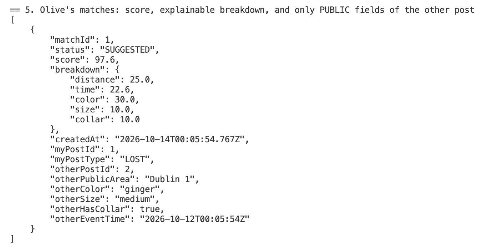
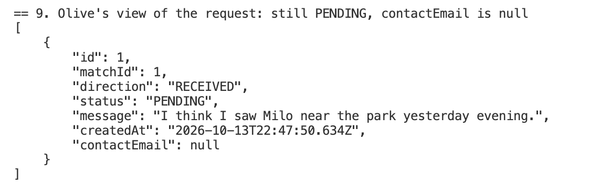
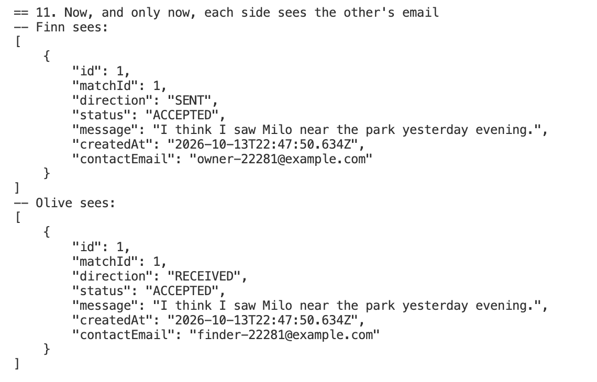
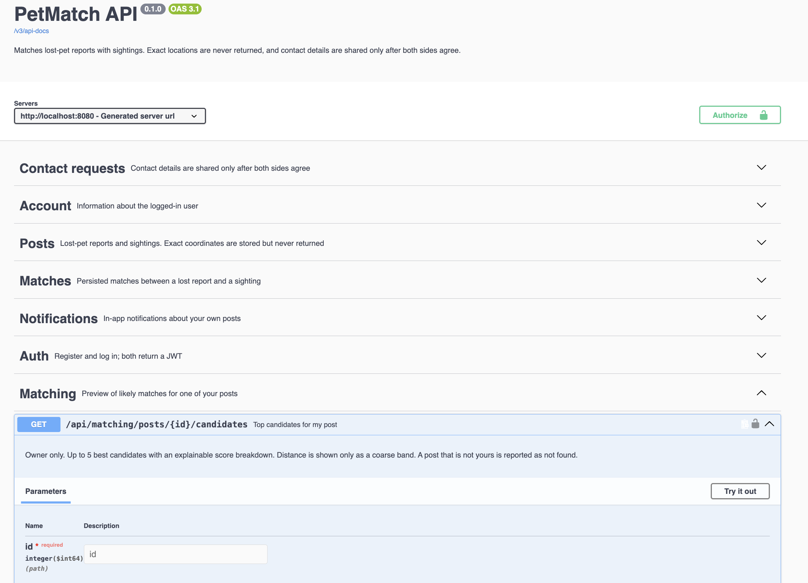
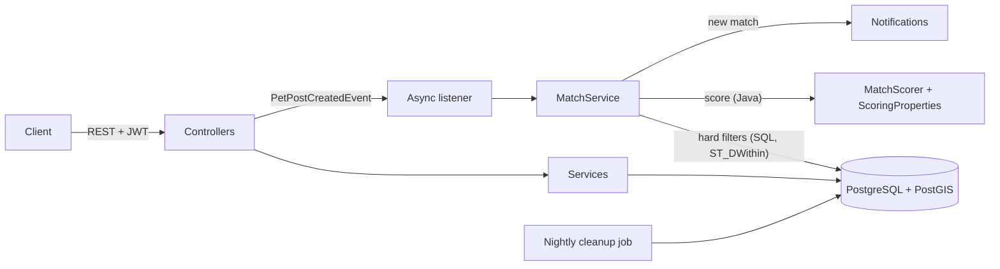

# PetMatch

[](https://github.com/jiwei-wu/petmatch/actions/workflows/ci.yml)

A backend that helps reunite lost pets with the people who spotted them. Owners post a **lost** report, passers-by post a **sighting**, and PetMatch finds the likely pairs: it filters by species, place and time with PostGIS, scores each pair with an explainable model, and tells both sides when a strong match appears.

It is built **privacy-first**: exact locations never leave the database, contact details are revealed only after both people agree, and data is deleted on a schedule.

> Java 21 · Spring Boot 4 · PostgreSQL + PostGIS · Flyway · Spring Security (JWT)

---

## Why this project

Lost-pet posts are scattered across social media, where they are hard to search and easy to miss. A good match depends on three things at once: *where* the pet was seen, *when*, and *what it looks like*. This project turns that into a backend problem:

- **Geospatial search** at the database level (PostGIS), not by loading rows into memory.
- **Explainable matching**: every suggestion comes with a score breakdown, not a black-box number.
- **Responsible handling of location data**, which is the most sensitive part of the whole domain.

## What it does

- Register / log in (stateless JWT, BCrypt-hashed passwords).
- Create, search, update, resolve and delete lost / sighting posts.
- **Automatic matching** in the background whenever a post is created.
- A ranked **candidate list** per post, with distance shown only as a coarse band.
- Persisted **matches**, in-app **notifications**, and **confirm / dismiss** decisions.
- **Contact requests**: the other person's email is revealed only after they accept.
- A nightly job that **expires old posts** and enforces **data retention**.

## Demo

Output of `./scripts/demo.sh`, trimmed to the three moments that matter.

**1. A match appears, with an explainable score and only public fields of the other post**



**2. The contact request is pending: the email is still hidden**



**3. After the owner accepts, and only then, both sides see each other's email**



**4. Interactive API docs (Swagger UI), with the privacy rules written into each endpoint**



## Architecture



**How a match is made**

1. A user creates a post. The controller saves it, then publishes an event.
2. A background thread picks up the event, so the poster never waits for matching.
3. **Hard filters in SQL** decide which pairs are even eligible (see below).
4. **Scoring in Java** ranks the eligible pairs. Pairs above a threshold are stored.
5. For every *new* match, both owners get a notification, in the same transaction.

Layers: `controller` → `service` → `repository`, plus `domain`, `dto`, `config`, `exception`, and a `matching` package that holds the scoring logic.

## The matching engine

Matching is split in two on purpose.

**1. Hard filters (done in the database).** A pair is only considered if:

- one is a lost report and the other a sighting;
- same species (case-insensitive);
- both posts are open and belong to different users;
- the sighting is within **10 km** (PostGIS `ST_DWithin`, backed by a GiST index);
- the sighting is **not earlier** than the loss, and within **30 days** of it.

**2. Weighted score out of 100 (done in Java).**

| Factor | Weight | Rule |
|---|---|---|
| Distance | 25 | Full score within 500 m, then halves every 500 m; the tolerated radius grows slowly the longer the pet has been missing (capped). |
| Time | 25 | Halves every 7 days between loss and sighting. |
| Colour | 30 | Synonym normalisation plus a hand-built similarity table; unknown colours get a neutral score. |
| Size | 10 | Same bucket 1.0, adjacent 0.5, otherwise 0. |
| Collar | 10 | Asymmetric: "owner says collar, finder saw none" is more plausible than the reverse. |

Missing fields get a neutral score instead of crashing or being punished.

**All numbers live in one class, `ScoringProperties`**, and can be overridden in `application.yaml` under `petmatch.scoring.*`. The logic in `MatchScorer` never needs to change when you tune a parameter, and there is a unit test that proves this.

### Evaluation on simulated data

There is no real data yet, so the matching model is evaluated on synthetic lost/sighting pairs: 2,000 lost cats, each with one true sighting hidden among about 30 look-alike distractors, where the true sighting may be reported with the wrong colour, the wrong size, or no collar noticed. Run it with `./mvnw -Dtest=MatchingEvaluationTest test`.

With the initial weights (40/20/20/10/10), in the baseline simulated world:

| Ranking | top-1 | top-5 |
|---|---|---|
| Random guess | 3.2% | 16.1% |
| Nearest sighting first | 55.9% | 73.6% |
| Weighted score | 61.3% | 79.6% |

Removing colour or time costs about 14 points of top-1; removing size or collar costs only 1 to 2 points.

**Retuning.** The same simulation showed that a distance weight of 40 was too high: when the true sighting is not very close, the distance term pushes it down the list. Rather than picking whatever scores best in one simulated world, the weights were compared across four worlds (baseline, more spread-out sightings, sloppier witnesses, more distractors) using random seeds that were not used while exploring (`WeightRobustnessTest`). The current 25/25/30/10/10 had the best worst-case result: on held-out seeds, the worst-world MRR rose from 0.52 to 0.64, and top-5 in the spread-out world from 59% to 85%.

> **Honest note.** All of this is simulated data built from my own assumptions, so it shows robustness to noisy reports, not real-world accuracy. Only the weights were tuned; the decay rates (500 m, 7 days) are still initial assumptions, loosely informed by a study of ~1,200 lost cats (Huang et al., 2018, *Animals* 8(1):5). That study measured distance from *home* and only covers recovered cats, so it cannot validate these numbers. Real feedback (confirmed and dismissed matches) is the proper next source of tuning data.

## Privacy by design

Location data about where someone's pet, and by extension their home, might be is sensitive. The rules below are enforced in code and covered by automated tests.

| Rule | How it is enforced |
|---|---|
| Exact coordinates never leave the database | Response DTOs have **no** coordinate field. Integration tests assert that no response body contains `latitude`, `longitude`, `exactLocation`, `userId` or the actual numbers. |
| Public location is coarse | Posts show only a public area label, never the point. |
| Distance is never exact | Candidate results expose only bands (`under 500 m`, `500 m - 1 km`, `1 - 5 km`, `5 - 10 km`). Repeated exact distances could be triangulated. |
| Only owners see their candidates | Other users cannot list candidates for your post. |
| No probing of ids | Acting on a match, request or notification that is not yours returns **404**, the same as one that does not exist. |
| Contact details stay hidden until consent | The other person's email is selected in SQL **only when a request is `ACCEPTED`**; for every other status the column is `NULL`. It cannot leak because of a mistake in the upper layers. |
| Anti-harassment | One contact request per person per match (a declined request cannot be resent) and a length-limited message. |
| Deletion is real | Deleting a post cascades to its matches and requests at the database level. |
| Retention | A nightly job expires overdue posts, permanently deletes posts 30 days after expiry, and deletes notifications older than 90 days (all configurable). |
| Authentication | Stateless JWT, BCrypt password hashing, owner-only update and delete. |

No scraping: the system never collects data from social networks. People submit posts themselves.

## API overview

All endpoints except authentication, `GET /api/posts/**` and the health check require `Authorization: Bearer <token>`.

| Area | Endpoint |
|---|---|
| Auth | `POST /api/auth/register`, `POST /api/auth/login` |
| Posts | `POST /api/posts`, `GET /api/posts` (`page`, `size`, `type`, `species`), `GET / PUT / DELETE /api/posts/{id}` |
| Candidates | `GET /api/matching/posts/{id}/candidates` (owner only, top 5 with score breakdown) |
| Matches | `GET /api/matches`, `POST /api/matches/{id}/confirm`, `POST /api/matches/{id}/dismiss` |
| Contact | `POST /api/matches/{id}/contact-requests`, `GET /api/contact-requests`, `POST /api/contact-requests/{id}/accept`, `POST /api/contact-requests/{id}/decline` |
| Notifications | `GET /api/notifications`, `POST /api/notifications/{id}/read` |
| Health | `GET /actuator/health` |

## Run it locally

**Requirements:** JDK 21 and Docker.

```bash
# 1. Start PostgreSQL + PostGIS
docker compose up -d

# 2. Start the app (Flyway creates the schema automatically)
./mvnw spring-boot:run
```

The app listens on `http://localhost:8080`. The default database settings and JWT secret in `application.yaml` are **for local development only**; override them with environment variables for anything else.

### API documentation

With the app running, open **http://localhost:8080/swagger-ui.html** for interactive API docs. Every endpoint has a short description that includes its privacy rules.

To try the protected endpoints from the page: call `POST /api/auth/register` (or `/api/auth/login`), copy the `token` from the response, click **Authorize**, and paste it. The raw OpenAPI document is at `/v3/api-docs`.

### See it work

With the app running, this script plays out a full story: two people register, one reports a lost cat, the other reports a sighting nearby, the match appears, both are notified, and a contact request is sent and accepted.

```bash
./scripts/demo.sh
```

It prints the JSON responses at each step, so you can see for yourself that coordinates never appear and that the other person's email stays hidden until the request is accepted. It needs only `curl` and `python3`.

## Tests

```bash
./mvnw clean test
```

Docker must be running: the integration tests start their own throw-away PostGIS container (Testcontainers), so there is nothing to set up and your development data is never touched. The first test class pays the container start-up cost once; the rest share it.

- **Unit tests** for the scoring model (no Spring, no database, run in milliseconds).
- **End-to-end integration tests** against a real PostgreSQL/PostGIS: authentication, post lifecycle, privacy guarantees, candidate ranking and hard filters, background matching, notifications, confirm / dismiss, the contact-request consent flow, and the cleanup job.
- **Simulated-data evaluation** of the matching model (`MatchingEvaluationTest`, `WeightRobustnessTest`): ablations, a nearest-first baseline, and a weight check across several simulated worlds. See "Evaluation on simulated data" above.

Asynchronous behaviour is tested by polling with a timeout, not by fixed sleeps.

## Design decisions

- **Filter in SQL, score in Java.** Filters can use the spatial index and discard most rows in the database; scoring rules change often and are easiest to unit-test as plain Java.
- **Idempotent matching.** Matches are stored with `INSERT ... ON CONFLICT DO NOTHING` on a unique constraint. Re-running is safe, concurrent runs are safe, and notifications are sent only for *newly created* matches.
- **Events + `@Async`.** Posting does not wait for matching, and a matching failure can never break a post that was already saved.
- **Coordinates as two `double` columns plus a generated `geography` column.** This keeps the spatial index and avoids a known Hibernate Spatial binary-encoding problem, without extra libraries.
- **Privacy in the data layer.** The most sensitive guarantees (no early email, cascade delete) are implemented in SQL and constraints rather than only in application code.

## Limitations (known and deliberate)

- Scoring parameters were checked and tuned on simulated data only, not fitted to real data (see "Evaluation on simulated data").
- The cleanup scheduler assumes a single running instance.
- No rate limiting, e-mail delivery or image uploads yet.

## Roadmap

- [x] Simulated-data generator and a matching evaluation (top-1 / top-3 / top-5 hit rate), then tune the weights
- [ ] Tune the decay rates (500 m, 7 days) and re-check the weights on real feedback
- [ ] Exact match on a hashed microchip number
- [x] OpenAPI / Swagger documentation
- [x] Dockerfile and one-command startup with `docker compose up --build`
- [x] Testcontainers: integration tests run against a throw-away PostGIS container
- [x] GitHub Actions CI
- [ ] A deployed demo
- [ ] Image upload with EXIF stripping
- [ ] Rate limiting and abuse reporting

## Project structure

```
src/main/java/com/petmatch/
  config/       security, async, scheduling, cleanup settings
  controller/   REST endpoints
  service/      business logic, background listener, nightly job
  repository/   Spring Data + native SQL (PostGIS)
  matching/     scoring model and its parameters
  domain/ dto/ exception/
src/main/resources/db/migration/   Flyway migrations (V1 ... V6)
```